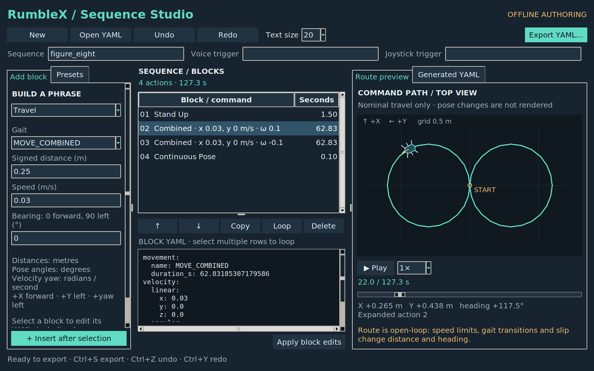

# Sequence Studio validation

The offline editor is launched with:

```bash
python3 rumblex_brain/tools/sequence_generator.py
```



## Automated checks

Focused checks run sequentially in a user-systemd scope with verified
`memory.high=6442450944`, `memory.max=8589934592`, and
`memory.swap.max=1073741824`, a 300-second timeout, the shared workload lock,
and one worker. See [resource limits](../BUILD_AND_TEST.md).

```text
python3 rumblex_brain/test/test_choreography.py
Ran 14 tests — OK

RUMBLEX_TEST_GUI=1 python3 rumblex_brain/test/test_sequence_generator.py
Ran 17 tests — OK
```

The original choreography tests check reproducible exports, saved-pose pairing,
section isolation, contact bookkeeping, input limits and composition. New tests
cover movement units, all five walking gaits, explicit velocity axes, analytic
route integration, clockwise/counterclockwise route closure, YAML round trips,
invalid input, bounded expansion, CLI operation, overwrite protection and failed
atomic exports. Five GUI cases exercise insertion, editing, draft saves/restores,
undo/redo, loops, reordering, preview, export, unsaved-edit cancellation, and
visibility of primary controls at 1080 × 720.

## Visual check and limits

The screenshot shows an editable figure-eight route with a 0.30 m radius,
0.03 m/s speed, and the preview scrubbed to 22 seconds. The editor was inspected
at 1600 × 1000 and 1080 × 720 on the development desktop. Font sizing accommodates
this desktop's mismatch between fontconfig DPI and Tk screen DPI. Long forms
scroll, and insertion/export/apply controls remain reachable at the smaller size.

No ROS node or robot command was started. This is a Python/GUI validation, not
a colcon/C++ rebuild, runtime parser integration test, Gazebo simulation or
hardware validation. The route integrates nominal body-frame velocity; it does
not simulate foot trajectories, controller speed caps, balance, collisions,
slip, sensor feedback or scheduler/audio delays.

## Larger-font update

Default interface text increased from 13 to 20 pixels and YAML text from 12 to
18 pixels. The toolbar now offers text sizes 16–28 and updates labels, controls,
YAML and map annotations together. Rows resize with the font; form labels wrap.
The default window is 1600 × 1000. Smaller windows retain the primary controls,
with less space for the preview and block descriptions.

All five existing `EditorTest` GUI checks passed again in the verified bounded
scope. A desktop check also confirmed that selecting 24 increases the rendered
font metrics and updates the YAML font, then returns to 20. The screenshot above
was refreshed with the new default.
